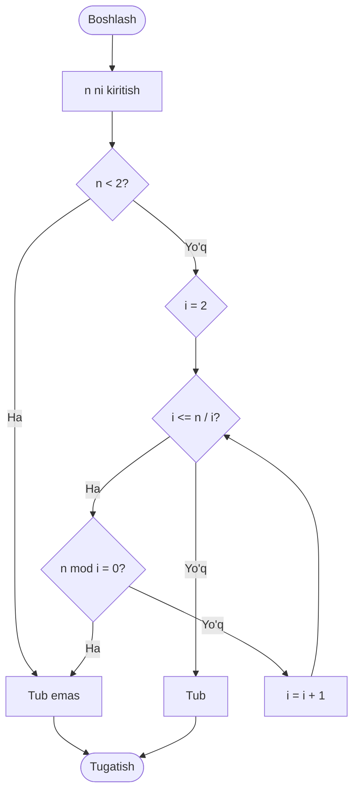
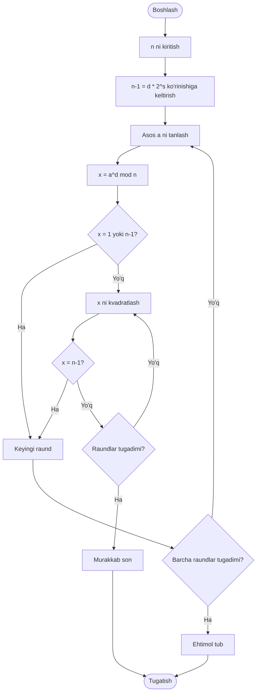

# Algoritm blok-sxemalari

## 1. Sinov bo'linish


## 2. 6k +/- 1
```mermaid
flowchart TD
 A([Boshlash]) --> B[n ni kiritish]
 B --> C{n < 2?}
 C -- Ha --> N[Tub emas]
 C -- Yo'q --> D{2 yoki 3 ga bo'linadimi?}
 D -- Ha --> N
 D -- Yo'q --> E[i = 5]
 E --> F{i <= n / i?}
 F -- Yo'q --> P[Tub]
 F -- Ha --> G{n mod i = 0?}
 G -- Ha --> N
 G -- Yo'q --> H{n mod (i+2) = 0?}
 H -- Ha --> N
 H -- Yo'q --> I[i = i + 6]
 I --> F
 N --> Z([Tugatish])
 P --> Z
```

## 3. Miller-Rabin asosiy g'oyasi

